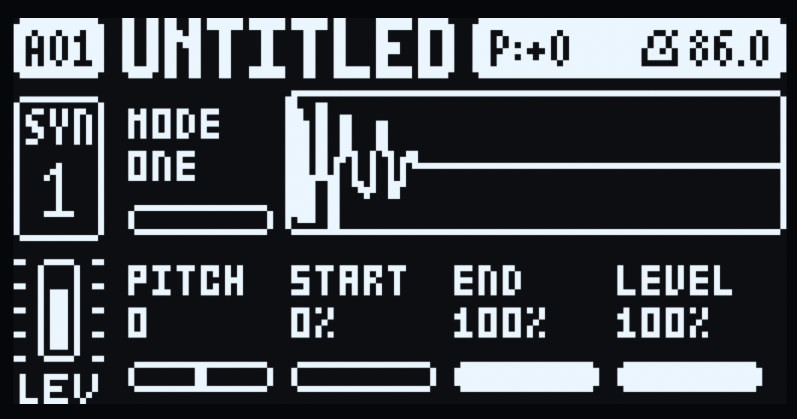
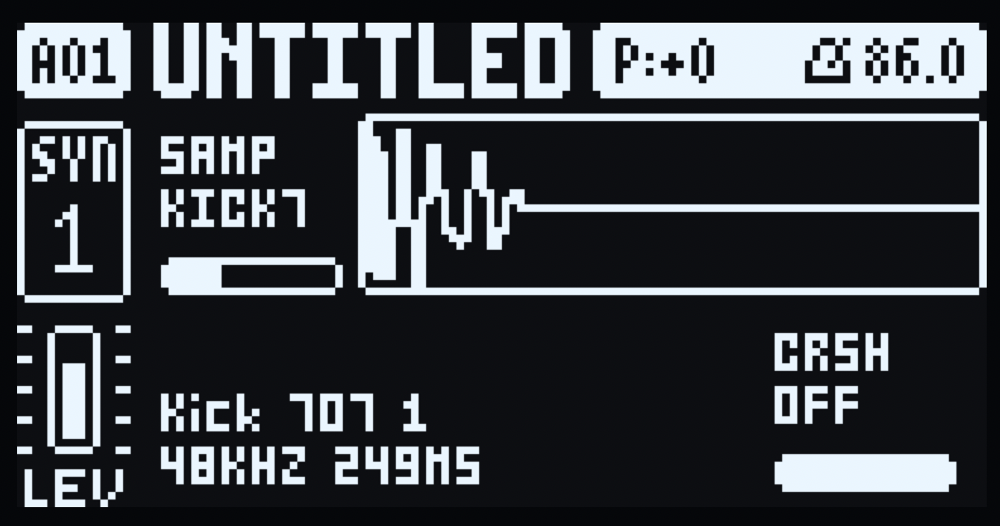

# SampleTone

A **sample-playback machine for the Elektron Digitone mk1 and Digitone Keys**
(OS 1.44). One mono one-shot per voice with start/end, reverse (start above end),
forward loop, note pitch tracking and a tune offset, through a bit-depth /
sample-rate crusher — and then through the Digitone's own multimode filter,
mixer, effects and AMP envelope, exactly as the FM voice does.

Pick it per track in **MACHINES** (hold a track key). A sound's machine lives in
its sound slot 0, so sound locks switch engines per trig, and p-locks, LFOs,
MIDI CC and presets work on its knobs as they do on FM.

No sample ships with this mod: you bake your own into the build
([Your own samples](#your-own-samples)).

## What you need

- A Digitone mk1 or Digitone Keys on **OS 1.44** (Elektron's download).
- [elekloader](https://github.com/irpina/elekloader) — the SDK, the cores and the
  `machines` companion this mod builds against. The tested revision is
  `b9006bf8b7c4e69becd7e2f16ec6b20ea52b8982`.
- **core-dn1 4.0 or newer** (it is in elekloader, under `mods/core-dn1`). Its
  1.25 MB mod area is what holds the code and the sample table; core 3.x has
  only 128 KB and cannot.
- An m68k cross toolchain (binutils + gcc; `m68k-elf-` or `m68k-linux-gnu-`).
- Python 3.8+ for `bake.py`. Nothing else — the baker uses only the standard
  library and reads WAV/AIFF itself.

## Your own samples

`bake.py` converts audio into the C table the machine plays. Mono, 48 kHz,
16-bit WAV is the ideal input and is copied frame for frame; anything else is
converted (other rates are linearly interpolated, other widths quantized to
16-bit). [samples/README.md](samples/README.md) has the format notes, the size
cap, the stereo downmix choice and every option.

`build.sh` runs it for you; by hand it is:

```sh
python3 bake.py --pack samples/          # bake every WAV/AIFF in samples/
python3 bake.py hit.wav --root 60 --name HIT
```

It writes `samples.c` and `samples.h` in place, and prints what it did per file
and which **SAMP** value selects which sample:

```
KICK7  Kick 707 1      11966 frames    0.25 s    23932 bytes  96k->48k 24b->16b
total 724900 bytes (cap 1200000); wrote samples.c and samples.h

SAMP (SYN2 A) picks among them: the engine reads index = value * 17 / 128.
  SAMP   0-7  CLAP7
  SAMP   8-15  COWBE
```

- **Cap.** 128 files and 1,200,000 bytes of PCM — about 12.5 s at 48 kHz mono
  16-bit, the room left in core-dn1 4.0's 1.25 MB area once the code is paid
  for. Over it the bake refuses and names the total: `--trim SECONDS`, a lower
  `--rate`, or fewer files bring it down.
- **Stereo sources need a choice**, because a voice is mono (the Digitone's pan,
  chorus, delay and reverb come after the machine's single 32-sample block).
  `--downmix mid` (default) sums both channels at half gain, so hard-panned
  content lands 6 dB down and out-of-phase content cancels; `--downmix left` or
  `--downmix right` keeps one channel. For real stereo, bake the two channels as
  two samples and run them on two tracks panned left and right.
- **Names and order.** Sorted by filename; the 5-character name and the page's
  title come from the file stem (`Kick 707 1.wav` → `KICK7`).
- **Changing the set means re-baking and re-flashing.** There is no runtime
  loading: a Digitone machine mod has no file API, and the mod is a patch to the
  OS image. `+Drive`/Transfer sample loading would need a core-level project.

## Build

```sh
git clone https://github.com/irpina/elekloader
git -C elekloader checkout b9006bf8b7c4e69becd7e2f16ec6b20ea52b8982

sh build.sh                       # samples/ + firmware/ -> out/sampletone-1.44-1.0a.syx
```

`build.sh` checks the firmware hash, bakes your samples into the table, builds
core-dn1, the machines companion and this mod, lints the result and patches the
image. It stops with a message if `samples/`, `firmware/` or the elekloader
checkout is missing, and it puts the shipped empty `samples.c`/`samples.h` back
afterwards (your pack stays in `out/samples-build/`). `sh build.sh --bake-only`
bakes and reports without a firmware file, and `--help` is the header comment.

By hand it is the same three builds and a patch:

```sh
export PYTHONPATH=$PWD/elekloader
export ELEKLOADER_CROSS=m68k-elf-         # your toolchain prefix
STOCK=firmware/Digitone_and_Digitone_Keys_OS1.44.syx

python3 -m elekloader.sdk.build elekloader/mods/core-dn1     --stock "$STOCK"
python3 -m elekloader.sdk.build elekloader/mods/machines-dn1 --stock "$STOCK"
python3 -m elekloader.sdk.build .                            --stock "$STOCK"
python3 -m elekloader.patch --stock "$STOCK" \
    --mod "$(ls -t elekloader/mods/core-dn1/out/core-*.elemod | head -1)" \
    --mod "$(ls -t elekloader/mods/machines-dn1/out/machines-*.elemod | head -1)" \
    --mod "$(ls -t out/sampletone-*.elemod | head -1)" \
    --out out/sampletone-1.44-1.0a.syx --version 1.0a
```

Flash the image with **Elektron Transfer** over USB, or any SysEx tool. The
record notes you baked into `samples.c` are part of the image, so a sample
change is a full re-flash.

**Recovery**, should anything go wrong: hold **FUNC** while powering on, press
**TRIG 4** (OS UPGRADE), then send the stock OS `.syx`. The bootloader is never
touched, so this always restores the unit.

## Controls

SYN1's first page and SYN2's first page become SampleTone's. Every control is a
stock parameter underneath, so values persist with the sound, p-lock, follow the
LFOs and MIDI CC, and survive a switch back to FM.

| SYN1 page | SYN2 page |
|---|---|
|  |  |

| knob | label | stock parameter | range / behaviour |
|---|---|---|---|
| SYN1 A | MODE | ALGO 107 (0–7) | 0–3 one-shot, 4–7 forward loop |
| SYN1 B–D | — | ratios 108–110 | unused; the FM ratio knobs still turn underneath |
| SYN1 E | PITCH | HARM 111 (37–89) | −26…+26 semitones, centre 63; the sample follows the played note |
| SYN1 F | START | DTUN 112 (0–127) | playback start, 0–100 % of the sample |
| SYN1 G | END | FDBK 113 (0–127) | playback end; START above END plays backwards |
| SYN1 H | LEVEL | MIX 114 (0–127) | sample gain, 0–100 % |
| SYN2 A | SAMP | 119 (0–127) | which baked sample plays |
| SYN2 B–G | — | 120–125 | unused |
| SYN2 H | CRSH | 126 B Level (0–127) | crusher: OFF at the top, then 12 bit / 18 kHz down to 2 bit / 2 kHz |

The stock **FLTR** page (filter) and **AMP** page (ATK/DEC/SUS/REL) stay stock and
apply after the engine; so does the MIXER.

Notes:

- **MODE** is split at the middle of ALGO's range so both halves turn with the
  same feel; the value reads `ONE` or `LOOP`.
- **PITCH** borrows HARM's stored 37–89 range (the firmware stores it offset by
  63 and the display subtracts it). At 0 the sample plays at its recorded pitch
  on its root note.
- **START/END** are inclusive and normalized to the sample; START = END is
  widened to one frame so nothing divides by zero.
- **SAMP** picks among the baked samples, so sound locks can switch samples per
  trig. Baking a different set changes what an existing sound's index points
  at: re-pick the machine (or re-set SAMP) afterwards.
- **CRSH** at the top of the knob is OFF and a bit-exact bypass; turning down
  drops the bit depth from 12 to 2 and the sample rate from 18 kHz to 2 kHz
  together, in one knob. It runs after interpolation and before LEVEL, so it
  crushes the sample and not the envelope.
- **Parameter locks.** Hold a trig while in GRID or STEP record: the page shows
  that step's locks — the locked cells invert and their values are the lock's,
  and the waveform's start/end markers follow them. Turning a knob with the trig
  held writes a lock, as on FM. In LIVE record or with RECORD off a held trig
  plays its note and the page keeps showing the kit, as stock.
- **Switching a track to SampleTone** sets the machine's defaults: PITCH 0,
  START 0, END, LEVEL and CRSH at the top (CRSH's top is OFF). They are applied
  on the switch, so re-pick the machine in MACHINES to get them back, and
  **FUNC + a knob** resets that knob to its default.
- Unused knobs (SYN1 B–D, SYN2 B–G) still turn their FM parameters underneath,
  unseen and unheard while the machine plays — an upstream limit. Switching back
  to FM restores FM's defaults for the knobs the machine owns.
- A tune, start or end change mid-note is applied without restarting the voice;
  SAMP is latched at note-on, so a note never changes sample halfway through.

## LFOs

Both of the Digitone's LFOs modulate the machine's knobs. The FM voice applies
its own LFOs, so a machine has to do it itself: each block the engine reads the
two LFOs' destination slot and signed modulation for its voice and adds them to
that knob, clamped to the stock parameter's range. Filter, AMP and FX
destinations are applied downstream of the voice and are left alone. The
housekeeping (SPD, MULT, FADE, WAVE, SPH, MODE, DEP) is the stock LFO page.

The destination list keeps the stock (FM) names, so pick the row that names the
knob you want:

| LFO destination | SYN knob |
|---|---|
| Algorithm | SYN1 A MODE |
| Harmonics | SYN1 E PITCH |
| Detune | SYN1 F START |
| Feedback | SYN1 G END |
| Mix | SYN1 H LEVEL |
| A Env Attack | SYN2 A SAMP (taken at note-on) |
| B Level | SYN2 H CRSH |

The other SYN2 rows (A Env Decay/End, A Level, B Env Attack/Decay/End) are
unused slots: an LFO aimed at one of them changes nothing.

## Signal path

```
samples.c (mono int16, native rate)
   -> 32.32 cursor: START/END, reverse, loop
   -> linear interpolation
   -> crusher: bit depth + sample-rate reduction   (SYN2 H CRSH)
   -> LEVEL gain
   -> AMP envelope + velocity        (machines companion, host AMP page)
   -> track multimode filter         (host FLTR page)
   -> mixer, chorus, delay, reverb, master
   -> out
```

The engine writes Q1.31 peaks around `DNM_PEAK`, the same reference as an FM
voice at the stock defaults, so track level and the mixer behave as for FM. The
render runs 1500 blocks a second on the main CPU; it uses no 64-bit multiply or
divide (core-dn1 exports neither), and one voice costs a fraction of the FM
engine's budget.

## Licence

GPL-2.0-or-later. Unofficial, not affiliated with Elektron.
